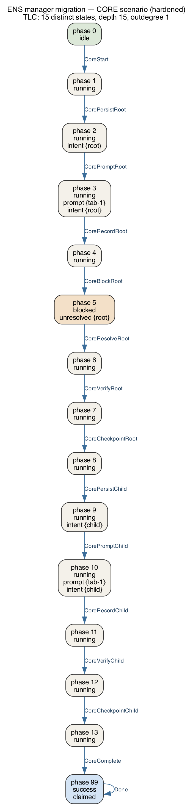

# Visualize the ENS migration TLA+ model

The model lives in the public `formal/migration-model` branch of [ensdomains/apps-monorepo](https://github.com/ensdomains/apps-monorepo/tree/formal/migration-model/apps/manager/verification/migration). The `.tla` and `.cfg` files match commit [`7a6b91c`](https://github.com/ensdomains/apps-monorepo/commit/7a6b91c3071ac8939b2f4059870c39062bff43a1). This folder does not copy those specs; it only has links, launch scripts, and reduced configs.

Working copy for TLC and VS Code (safe to write): `~/fv-visual/migration`. Do not run TLC or edit files in the `apps-monorepo-formal-verification` worktree.

## 1. Spectacle (browser) — partial until opened in a browser

Spectacle explores a spec by stepping states in the browser. It loads a raw GitHub URL via the `specpath` parameter, and sibling modules such as `MigrationContract.tla` from the same directory.

Direct link for the detailed model, hardened, CORE scenario only:

https://will62794.github.io/spectacle/#!/home?specpath=https%3A%2F%2Fraw.githubusercontent.com%2Fensdomains%2Fapps-monorepo%2Fformal%2Fmigration-model%2Fapps%2Fmanager%2Fverification%2Fmigration%2FModel.tla&constants%5BModelMode%5D=%22hardened%22&constants%5BDisabledGuard%5D=%22None%22&constants%5BEnabledScenarios%5D=%7B%22CORE%22%7D

Same link pinned to the verified commit:

https://will62794.github.io/spectacle/#!/home?specpath=https%3A%2F%2Fraw.githubusercontent.com%2Fensdomains%2Fapps-monorepo%2F7a6b91c3071ac8939b2f4059870c39062bff43a1%2Fapps%2Fmanager%2Fverification%2Fmigration%2FModel.tla&constants%5BModelMode%5D=%22hardened%22&constants%5BDisabledGuard%5D=%22None%22&constants%5BEnabledScenarios%5D=%7B%22CORE%22%7D

Direct link for the contract stub alone:

https://will62794.github.io/spectacle/#!/home?specpath=https%3A%2F%2Fraw.githubusercontent.com%2Fensdomains%2Fapps-monorepo%2Fformal%2Fmigration-model%2Fapps%2Fmanager%2Fverification%2Fmigration%2FMigrationContract.tla&constants%5BTabs%5D=%7B%22tab-1%22%2C%22tab-2%22%7D&constants%5BNames%5D=%7B%22root.eth%22%2C%22child.root.eth%22%7D&constants%5BHonestJournal%5D=TRUE&constants%5BHonestChain%5D=TRUE&constants%5BHonestWallet%5D=TRUE&constants%5BFairResponses%5D=TRUE

These URLs were built from Spectacle's documented query parameters. They have not been opened in a browser here, so please confirm they parse and show an initial state.

If the hosted link fails, the usual causes are `Model.tla`'s `INSTANCE MigrationContract WITH ...` (supported, but there have been interpreter bugs) or the 1,409-line spec being heavy for the JavaScript interpreter. Workaround: from this folder run `scripts/start-spectacle.sh`, then in http://127.0.0.1:8000 use Load → From local server → `Model.tla`, and set the same three constants. `CertifiedRegistryPathProof.tla` is a theorem stub with no `Init`/`Next`, so it is not useful in Spectacle.

## 2. VS Code TLA+ extension and debugger — works locally

VS Code on the Mac mini has [TLA+ for VS Code](https://marketplace.visualstudio.com/items?itemName=tlaplus.vscode-ide) `v2026.11.191813` installed. Java is pointed at the mise Temurin 25 JDK.

```sh
tools/visualize-migration/scripts/open-vscode.sh
```

That opens `~/fv-visual/migration` with `Graph-CORE.cfg` in front. Then:

- Command Palette → **TLA+: Check model with TLC** — run the open `.cfg`, then inspect the result panel and any error trace.
- Command Palette → **TLA+: Check and debug model with TLC** — set a **Halt (break) after Init and Next** breakpoint to step the state machine the way Spectacle does. See the [debugger docs](https://docs.tlapl.us/using:debugger).
- Command Palette → **TLA+: Visualize TLC output** — open a counterexample from a `No*.cfg` mutation.

The debugger uses whichever `.tla` or `.cfg` is the active editor. A launch config is in `configs/launch.json` and is copied into the working copy.

## 3. TLC state graph — works

TLC was run on a copy (not the worktree) with `Graph-CORE.cfg`:

- Constants: `ModelMode = "hardened"`, `DisabledGuard = "None"`, `EnabledScenarios = {"CORE"}`
- Result, 23 Nov 2026, 17:31 Asia/Taipei: **16 states generated, 15 distinct, depth 15, outdegree 1**. No errors.
- The CORE run is a single path, then a `Done` self-loop at success.

`idle --CoreStart--> persist root --> prompt --> record hash --> block (receipt unavailable) --> resolve --> verify --> checkpoint --> persist child --> prompt --> record --> verify --> checkpoint --> complete --> success`

The raw TLC DOT labels are the full state record and render as a 28,845-pixel-tall PNG. The compact graph keeps phase, lifecycle, and a few interface fields:



A wide left-to-right strip is in [`preview/Model-CORE-compact.svg`](preview/Model-CORE-compact.svg). Full-label DOT/PNG/SVG stay in `~/fv-visual/migration/out/` and are not committed.

To regenerate:

```sh
tools/visualize-migration/scripts/render-state-graph.sh          # CORE
tools/visualize-migration/scripts/render-state-graph.sh Graph-A1.cfg
```

Needs Graphviz (`brew install graphviz`, already installed) and the mise Java / `tla2tools` 1.7.4 already used by the monorepo verifier. Do not use Current.cfg or Hardened.cfg for a graph: those enable all 37 scenarios and will not render usefully.

## 4. Other TLA+ visual tools

| Tool | Status |
| --- | --- |
| TLA+ Toolbox trace explorer | Skipped. The Toolbox is not installed, and the VS Code extension covers checking, debugging, and error-trace views. |
| Spectacle trace viewer | Ready only after you step or paste a Spectacle trace into a share link. TLC error traces do not use Spectacle's state hashes, so they cannot be pasted in directly. |
| `CertifiedRegistryPathProof.tla` | Not a behavioral model (theorem stub). |
| `Model.view.mjs` / pstack | Already documented in the monorepo migration README for product-language statecharts. Not set up here. |

## Paths

| What | Where |
| --- | --- |
| Public specs | https://github.com/ensdomains/apps-monorepo/tree/formal/migration-model/apps/manager/verification/migration |
| Read-only worktree | `~/projects/ensdomains/apps-monorepo-formal-verification/apps/manager/verification/migration` |
| Working copy | `~/fv-visual/migration` |
