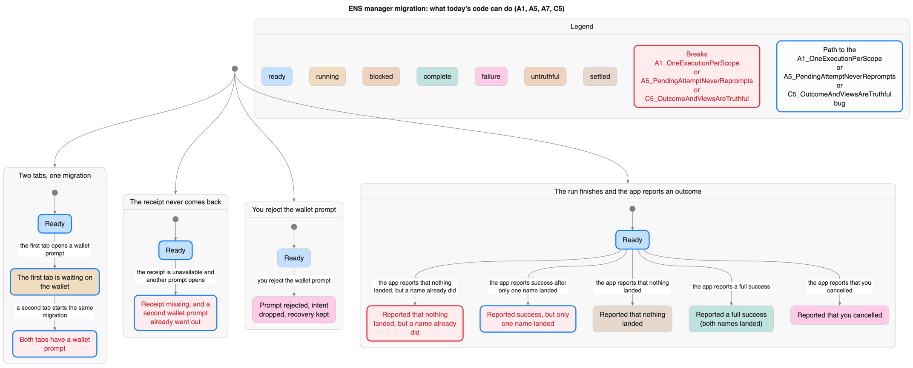

# Visualize the ENS migration TLA+ model

The model lives in the public `formal/migration-model` branch of [ensdomains/apps-monorepo](https://github.com/ensdomains/apps-monorepo/tree/formal/migration-model/apps/manager/verification/migration). The `.tla` and `.cfg` files match commit [`7a6b91c`](https://github.com/ensdomains/apps-monorepo/commit/7a6b91c3071ac8939b2f4059870c39062bff43a1). This folder does not copy those specs.

Working copy for TLC and charts (safe to write): `~/fv-visual/migration`. Do not run TLC or edit files in the `apps-monorepo-formal-verification` worktree.

## The chart to look at: pstack `/statechart`

The CORE TLC state graph is a straight line of 15 states, each labelled with the full variable dump. That is not a useful picture. The chart below is drawn with Cursor's [pstack `/statechart` skill](https://github.com/cursor/plugins/tree/main/pstack/skills/statechart) (MIT License, Copyright (c) 2026 Lauren Tan). The skill is not vendored here; clone it locally to regenerate.

It uses `Graph-Branching.cfg`: `ModelMode = "current"` (today's code, including the missing guards) and `EnabledScenarios = {"A1", "A5", "A7", "C5"}`. Those four flows are short enough to read, C5 actually branches (five report actions from one ready state), and A1, A5, and C5 are the ones `current-expectations.tsv` says will violate their invariants, so the red `breaks` marks appear. A7 holds, as a contrast. The view is `MigrationView.mjs`. TLC reached 13 states and 17 steps; the chart draws 13 states and 9 arrows. The eight hidden steps are the terminal `Done` stutter.



- Red border: a state that breaks a rule. "Both tabs have a wallet prompt" breaks `A1_OneExecutionPerScope`. "Receipt missing, and a second wallet prompt already went out" breaks `A5_PendingAttemptNeverReprompts`. The two untruthful C5 reports break `C5_OutcomeAndViewsAreTruthful`.
- Blue border: a state on the shortest path to one of those bugs.
- The honest C5 reports (full success, nothing landed, cancelled) and the wallet-rejection flow (A7) are not marked.

Mermaid source: [`preview/statechart-branching.mmd`](preview/statechart-branching.mmd). SVG: [`preview/statechart-branching.svg`](preview/statechart-branching.svg). The pstack report: [`preview/statechart-branching-report.md`](preview/statechart-branching-report.md).

To regenerate (needs the skill at `~/fv-visual/pstack`, plus mise Temurin 25 and `tla2tools` 1.7.4):

```sh
tools/visualize-migration/scripts/run-statechart.sh /tmp/migration-chart
```

Then render `chart.mmd` with [`pele@1.9.0`](https://pele.run/api) as described in the skill's `references/render.md`.

## Spectacle

The hosted link does load this model. In headless Chrome it fetched both `Model.tla` and `MigrationContract.tla` (HTTP 200), parsed `INSTANCE MigrationContract WITH ...` at Model.tla:1396, and showed 1 initial CORE state. The model's TLA+ (records, `EXCEPT`, `INSTANCE ... WITH`, standard `FiniteSets`/`Sequences`) is not the problem.

What the hosted page does log:

- `Failed to load resource: the server responded with a status of 404 ()` for the optional `Model_anim.tla` (Spectacle always probes a sibling animation file; this is harmless).
- `Access to XMLHttpRequest at 'http://127.0.0.1:8000/api/local_dir_files' from origin 'https://will62794.github.io' has been blocked by CORS policy: Permission was denied for this request to access the loopback address space.` Spectacle always probes a local server. Chrome's Private Network Access blocks that from GitHub Pages, and mithril then throws `Error: null` (`mithril.min.js`). That exception is the most likely thing a browser shows as a failure.

Workaround: `scripts/start-spectacle.sh`, then Load → From local server → `Model.tla`, with `ModelMode="hardened"`, `DisabledGuard="None"`, `EnabledScenarios={"CORE"}` (or the branching constants). Local Spectacle showed the same initial state with no mithril error.

[Hosted CORE link](https://will62794.github.io/spectacle/#!/home?specpath=https%3A%2F%2Fraw.githubusercontent.com%2Fensdomains%2Fapps-monorepo%2Fformal%2Fmigration-model%2Fapps%2Fmanager%2Fverification%2Fmigration%2FModel.tla&constants%5BModelMode%5D=%22hardened%22&constants%5BDisabledGuard%5D=%22None%22&constants%5BEnabledScenarios%5D=%7B%22CORE%22%7D) — use it if the localhost probe error does not cover the page.

## Other TLA+ visual tools (brief)

| Tool | Link | On this model |
| --- | --- | --- |
| pstack `/statechart` | [skill](https://github.com/cursor/plugins/tree/main/pstack/skills/statechart) | Works. This is the chart above. |
| Spectacle explorer | [repo](https://github.com/will62794/spectacle) / [2018 animation paper](https://conf.tlapl.us/2018/schultz.pdf) / [2024 talk](https://conf.tlapl.us/2024/WillSchultz-TowardsBetterInteractiveFormalSpecifications.pdf) | Loads and steps; better for walking a trace than for a readable graph. Hosted page probes localhost (see above). |
| TLA+ animation module + VS Code debugger | [official guide](https://github.com/tlaplus/vscode-tlaplus/blob/master/resources/knowledgebase/tla-animations.md), [debugger](https://docs.tlapl.us/using:debugger), [CommunityModules `SVG.tla`](https://github.com/tlaplus/CommunityModules/blob/master/modules/SVG.tla) | Installed (extension + Temurin 25). Official way to step states with an `AnimView`. Not set up here; would need a `Model_anim.tla` in the working copy. |
| TLC `VIEW` / `ALIAS` + `-dump dot` | [wiki](https://docs.tlapl.us/using:generating_state_graphs), [Learn TLA+](https://learntla.com/topics/optimization.html) | Works, but a raw dump of CORE is a 15-state line with huge labels. A `VIEW` does not invent branching that the config does not have. |
| ProB projection diagrams | [docs](https://prob.hhu.de/w/index.php/State_Space_Visualization), [Ladenberger & Leuschel, ICFEM 2015](https://link.springer.com/chapter/10.1007/978-3-319-25423-4_10) | The right tool for projecting a large state space onto a few expressions. Not installed; skipped in favor of pstack. |
| Apalache ITF trace viewer | [ITF ADR](https://apalache-mc.org/docs/adr/015adr-trace.html), [vscode-itf-trace-viewer](https://github.com/informalsystems/vscode-itf-trace-viewer) | Trace tables, not a state graph. Apalache is not installed. |
| TLA+ Toolbox state-graph tab | [wiki](https://docs.tlapl.us/using:generating_state_graphs) | Not installed; same DOT dump as TLC. |
| VS Code "Visualize TLC output" / sequence diagrams | [visualizing states](https://docs.tlapl.us/using:vscode:visualizing_states) | Good for a counterexample trace, not for the reachable graph. |

## Paths

| What | Where |
| --- | --- |
| Public specs | https://github.com/ensdomains/apps-monorepo/tree/formal/migration-model/apps/manager/verification/migration |
| Read-only worktree | `~/projects/ensdomains/apps-monorepo-formal-verification/apps/manager/verification/migration` |
| Working copy | `~/fv-visual/migration` |
| pstack skill (local, not in this repo) | `~/fv-visual/pstack/pstack/skills/statechart` |
