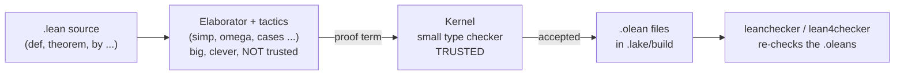

# Lean 4 for TypeScript engineers: reading the files agents produce

For: an ENS Labs TypeScript/React engineer who is new to Lean. This picks up after the [TLA+ walkthrough](./tla-plus-walkthrough.md).
Example project: [`lean-examples/`](./lean-examples/), original code written for this primer. It models the property that is still a stub in [`CertifiedRegistryPathProof.tla`](https://github.com/ensdomains/apps-monorepo/blob/formal/migration-model/apps/manager/verification/migration/CertifiedRegistryPathProof.tla) on the `formal/migration-model` branch of `ensdomains/apps-monorepo`.
Builds: run on 2026-11-16 (UTC+8) with Lean 4.35.0 on x86_64 Linux. Every output below is copied from a real run. The logs are in [`lean-examples/logs/`](./lean-examples/logs/).

The same file types appear in your local Lean experiments, so everything here carries over.

---

## 1. The 5-minute mental model

**Lean is a functional programming language whose type checker can also check proofs.** You write ordinary definitions (`def`), and you write claims about them (`theorem`). A claim is a *type*. A proof is a *value of that type*. If the file compiles, every proof in it has been checked.

| Lean idea | Plain meaning | TypeScript analogy |
|---|---|---|
| `def f (x : Nat) : Nat := ...` | a function | `const f = (x: number): number => ...` |
| `structure` | a record type | `type Registry = { certified: boolean; subs: ... }` |
| `inductive` | a sum type with named cases | a discriminated union `{ kind: "a" } \| { kind: "b" }` |
| `match` | pattern match on cases | `switch (x.kind)` that the compiler checks is exhaustive |
| `Prop` | the type of statements (things that can be proved) | no real equivalent; think "a type whose values are evidence" |
| `theorem name : Statement := proof` | "here is evidence that Statement holds" | a value that only typechecks if the claim is true |
| `by tac1; tac2` | build the proof step by step with *tactics* | an interactive codemod that fills in the value for you |
| goal | what is still left to prove at this point in a `by` block | the "expected type" at a hole in your code |
| `sorry` | "trust me, I'll prove this later" | `as any`: it compiles, and it proves nothing |

How TLC and Lean differ:

| | TLA+ / TLC | Lean |
|---|---|---|
| How it checks | runs every state of a **finite** model | checks a **proof** that covers every input, including infinitely many |
| You write | the model + the properties | the model + the properties + **the proof** |
| A failure looks like | a counterexample trace | "unsolved goals" or a type mismatch (no counterexample, just "I couldn't finish") |
| A pass means | no bad state within the bounds you configured | true for all inputs, *relative to the definitions and axioms* |

### The kernel is the only part you have to trust



Tactics like `simp` and `omega` are big pieces of automation, and they can have bugs. That doesn't matter for soundness, because a tactic only *builds* a proof term, and the small kernel then re-checks that term. A buggy tactic can fail to find a proof, but it can't make the kernel accept a false one. The things you *do* have to trust are:

1. the kernel (small, and it can be cross-checked by independent re-implementations),
2. any **axioms** the proof uses (section 6),
3. that the **theorem statement says what you meant**. Nothing in Lean checks this, and it's where agent-written proofs most often go wrong.

The Lean reference has a page on exactly this: [Validating a Lean Proof](https://lean-lang.org/doc/reference/latest/ValidatingProofs/).

---

## 2. Project anatomy: the files an agent leaves behind

```
lean-examples/
├── lean-toolchain        ← which Lean version (like .nvmrc)
├── lakefile.toml         ← build config (like package.json "scripts" + workspaces)
├── lake-manifest.json    ← pinned dependency revisions (like package-lock.json)
├── EnsExample.lean       ← root module of the library: just imports
├── EnsExample/
│   ├── Registry.lean     ← definitions + theorems  (module EnsExample.Registry)
│   └── Concrete.lean     ← a concrete world, #eval, decide, #print axioms
├── demos/                ← not part of the build target: broken / escape-hatch demos
└── .lake/                ← build output + downloaded deps (like node_modules + dist). gitignored
```

| File | What it is | What to look at |
|---|---|---|
| `lean-toolchain` | one line, e.g. `leanprover/lean4:v4.35.0`. [elan](https://github.com/leanprover/elan) (Lean's `nvm`) reads it and downloads that exact compiler. | Is it pinned to a release, not `nightly`? |
| `lakefile.toml` (or `lakefile.lean`) | Config for [Lake](https://lean-lang.org/doc/reference/latest/Build-Tools-and-Distribution/Lake/), Lean's build tool. `[[lean_lib]] name = "EnsExample"` means "build module `EnsExample` and everything it imports". `defaultTargets` is what plain `lake build` builds. `[[require]]` blocks add dependencies (e.g. Mathlib). | Which files are actually built? A proof in a file nobody imports is never checked by `lake build`. |
| `lake-manifest.json` | Generated by Lake. Records the exact git revision of every dependency. Ours has `"packages": []`, so no dependencies, not even Mathlib. | Commit it. Changes to it are dependency upgrades. |
| `.lake/` | Build artifacts: `.olean` (compiled, kernel-checked modules), `.ilean` (editor index), C output, and `packages/` for dependencies. | Never commit it. Delete it to force a clean rebuild. |
| `Foo/Bar.lean` | Module `Foo.Bar`. The **path is the module name**: `import EnsExample.Registry` loads `EnsExample/Registry.lean`. | |

Our `lakefile.toml`, in full:

```toml
name = "ens-lean-example"
version = "0.1.0"
defaultTargets = ["EnsExample"]

[[lean_lib]]
name = "EnsExample"
```

`namespace EnsExample ... end EnsExample` inside a file is separate from the module name. It prefixes declarations, so `walk` is really `EnsExample.walk`, like a TS namespace or module export. `open Foo` brings `Foo.x` into scope as `x`.

**Mathlib.** Many Lean projects depend on [Mathlib](https://github.com/leanprover-community/mathlib4), the big community math library. It's several GB, and you normally fetch prebuilt `.olean`s with `lake exe cache get`. This example uses only Lean core, so it builds in seconds.

---

## 3. Install and build (real run)

```sh
curl -sSfL https://raw.githubusercontent.com/leanprover/elan/master/elan-init.sh -o elan-init.sh
sh elan-init.sh -y --default-toolchain leanprover/lean4:v4.35.0
source ~/.elan/env
cd lean-examples && lake build
```

Real output ([`logs/lake-build.log`](./lean-examples/logs/lake-build.log)):

```
✔ [2/5] Built EnsExample.Registry (359ms)
ℹ [3/5] Built EnsExample.Concrete (302ms)
info: EnsExample/Concrete.lean:14:0: [0, 1, 2]
info: EnsExample/Concrete.lean:15:0: [0, 1]
info: EnsExample/Concrete.lean:45:0: 'EnsExample.root_walk_certified' depends on axioms: [propext]
info: EnsExample/Concrete.lean:46:0: 'EnsExample.safeSetSub_preserves' depends on axioms: [propext, Classical.choice, Quot.sound]
info: EnsExample/Concrete.lean:47:0: 'EnsExample.hijacked_visits_foreign' depends on axioms: [propext, Quot.sound]
info: EnsExample/Concrete.lean:48:0: 'EnsExample.demo_walk_native' depends on axioms: [demo_walk_native._native.native_decide.ax_1_1]
✔ [4/5] Built EnsExample (260ms)
Build completed successfully (5 jobs).
```

How to read it:
- `✔` means built clean. `ℹ` means built, but the file printed messages (`#eval` and `#print axioms` output show up as `info:`). `⚠` would be a warning, and **`declaration uses 'sorry'` is a warning, not an error**. `✖` means an error.
- `file:line:col` points at the command that printed the message.
- The `#eval` lines run code: `[0, 1, 2]` is the list of registries visited when resolving `nick.eth`.
- The four `#print axioms` lines are the trust report. Section 6 goes through them.

For everyday work you'll use the editor instead: VS Code plus the official Lean 4 extension. It shows the **infoview**, which is the goal state at the cursor (section 5). The [install page](https://lean-lang.org/install/) covers it.

---

## 4. Line-by-line: `EnsExample/Registry.lean`

The TLA+ stub states:

> Every registry reachable from the root registry only links subregistries that are certified ENS registries, so a traversal from root to any name never passes through a foreign subregistry. … Until replaced, CertifiedRegistryPath is ASSUMED, not proved.
> ([CertifiedRegistryPathProof.tla](https://github.com/ensdomains/apps-monorepo/blob/formal/migration-model/apps/manager/verification/migration/CertifiedRegistryPathProof.tla))

Our toy proves a version of that in Lean, about a **toy model** rather than the v2 contracts. That gap is the same kind as the TLA+ model versus the real TypeScript.

### 4.1 Types (L10-L24)

```lean
abbrev RegId := Nat
abbrev Label := String

structure Registry where
  certified : Bool
  subs : List (Label × RegId)
  deriving Repr

abbrev World := RegId → Option Registry
```

- `abbrev` is a type alias (`type RegId = number`). `Nat` is the non-negative integers, unbounded (no overflow). `Int` is the signed version.
- `structure` is a record. `subs` is a list of `(label, childId)` pairs. `Label × RegId` is a tuple type (`[string, number]`).
- `deriving Repr` auto-generates a printer so `#eval` can show values (like a derived `toString`). You'll also see `deriving DecidableEq`, which auto-generates `===` for the type.
- `World` is a *function* from id to `Option Registry`. `Option` is `T | undefined` with explicit cases `some reg` / `none`. Modelling "the chain" as a function is common in Lean.
- `/-- ... -/` is a doc comment, and `-- ...` is a line comment.

### 4.2 `def` with `match` (L27-L43)

```lean
def isCertified (w : World) (r : RegId) : Bool :=
  match w r with
  | some reg => reg.certified
  | none => false

def walk (w : World) (r : RegId) : List Label → List RegId
  | [] => [r]
  | l :: ls =>
    match w r with
    | none => [r]
    | some reg =>
      match reg.subs.lookup l with
      | none => [r]
      | some child => r :: walk w child ls
```

- Function application has no parentheses or commas: `w r` is `w(r)`, and `walk w child ls` is `walk(w, child, ls)`.
- `walk` takes `w` and `r` as named parameters, then pattern-matches its **third** argument (the label list) directly with `| [] => ... | l :: ls => ...`. `l :: ls` means "head `l`, tail `ls`" (`const [l, ...ls] = labels`).
- `r :: walk w child ls` builds a list: `[r, ...walk(w, child, ls)]`.
- `walk` is recursive. Lean **insists every function terminates**, and here it can see that the list gets shorter on each call. If it can't see that, you'll get an error or a `termination_by` clause in agent code.
- `List.lookup l` returns the **first** pair whose key is `l`. That matters later, because adding a link at the front shadows older ones.
- Labels are root-first: `nick.eth` is `["eth", "nick"]`.

### 4.3 A `Prop`: the invariant (L48-L51)

```lean
def CertifiedLinksOnlyCertified (w : World) : Prop :=
  ∀ r reg l child,
    w r = some reg → reg.certified = true →
    reg.subs.lookup l = some child → isCertified w child = true
```

- The return type is `Prop`, so this `def` defines a **statement**, not a computation. Read `∀` as "for all", and read `A → B → C` as "if A and B, then C".
- In English: "for every registry `r` that exists and is certified, anything it links under any label is certified."
- Compare the stub: `\A r \in Registries : \A s \in SubregistryOf[r] : s \in Certified`. The stub requires this of *every* registry. Ours requires it only of certified ones. That's weaker, but enough, because the walk starts at a certified root. Checking that a formal statement says what the English says is the most important review step (section 8).
- `= true`: `isCertified` returns a `Bool` (a runtime value), and a statement needs a `Prop`. `b = true` turns one into the other.

### 4.4 `theorem` and the `by` block (L55-L85)

```lean
theorem walk_certified (w : World) (hinv : CertifiedLinksOnlyCertified w) :
    ∀ (labels : List Label) (r : RegId),
      isCertified w r = true → ∀ x ∈ walk w r labels, isCertified w x = true := by
```

- `theorem name (args) : STATEMENT := PROOF`. It's shaped exactly like `def name (args) : Type := value`. The only difference is that the type is a statement, and Lean never runs a theorem.
- `(hinv : CertifiedLinksOnlyCertified w)` is a **hypothesis**: the theorem only promises anything when the invariant holds. Naming hypotheses `h…` is a convention.
- `:= by` switches to tactic mode. Each line transforms the current goal until none are left. Without `by`, you write the proof term directly, as in `root_walk_certified` at L90-L94, which just *calls* `walk_certified` like a function: `walk_certified w hinv name root hroot`. **Using a theorem is calling a function that returns evidence.**

The tactics, line by line:

| Line | Tactic | What it does |
|---|---|---|
| 58 | `intro labels` | Goal is `∀ labels, …`. Introduce a fresh `labels` (like the parameter of an arrow function). |
| 59 | `induction labels with` | Proof by induction on the list: prove it for `[]` (`nil`) and for `l :: ls`, assuming it for `ls` (`cons`, with induction hypothesis `ih`). This is the proof version of a recursive function. |
| 61 | `intro r hr x hx` | Peel off `∀ r`, the hypothesis `hr : isCertified w r = true`, `∀ x`, and `hx : x ∈ walk w r []`. |
| 62 | `simp [walk] at hx` | Simplify `hx` using `walk`'s definition: `x ∈ [r]` becomes `x = r`. |
| 63 | `subst hx` | Replace `x` with `r` everywhere. |
| 64 | `exact hr` | The goal is now literally `hr`. Done. |
| 67 | `unfold walk at hx` | Expand `walk` one step in `hx`, exposing its `match`es. |
| 68, 76 | `cases hw : w r with \| none => … \| some reg => …` | Case-split on the value of `w r`, and remember which case you're in as `hw`. This mirrors the `match` in `walk`. |
| 74-75 | `have hcert : … := by simpa [isCertified, hw] using hr` | Prove a helper fact inline. `simpa … using hr` means "simplify `hr` and the goal, then they match". |
| 83 | `cases hx with \| inl h => … \| inr h => …` | `hx` is `x = r ∨ x ∈ walk w child ls`. Handle each side of the OR. |
| 85 | `exact ih child (hinv r reg l child hw hcert hl) x h` | The key step. `hinv` (the invariant) proves `child` is certified, and `ih` (the induction hypothesis) handles the rest of the walk. |

`·` (or `|` branches) focuses on one goal. Indentation matters, as in Python.

### 4.5 Keeping the invariant true (L99-L146)

```lean
def setSub (w : World) (parent : RegId) (label : Label) (child : RegId) : World :=
  fun r =>
    if r = parent then
      (w r).map (fun reg => { reg with subs := (label, child) :: reg.subs })
    else w r

def safeSetSub (w : World) (parent : RegId) (label : Label) (child : RegId) : World :=
  if isCertified w child then setSub w parent label child else w
```

- `fun r => …` is a lambda (`(r) => …`). `{ reg with subs := … }` is `{ ...reg, subs: … }`. `(w r).map` is `Option.map`, like `?.`.
- `safeSetSub_preserves` proves that the **guarded** update keeps `CertifiedLinksOnlyCertified` true. This is the "construction invariant" shape. If every allowed operation preserves the invariant, then every world you can build has it. That's the same pattern as a TLA+ inductive invariant.
- New tactics in that proof: `by_cases h : P` splits into "P holds" and "P doesn't hold". `rw [lemma]` rewrites the goal using an equation. `simp only [hc, ite_true]` simplifies with *only* the listed facts. `cases w x <;> simp` runs `simp` on every case that `cases` produces (`<;>` means "then, on all resulting goals").

### 4.6 `Concrete.lean`: running and deciding

```lean
def demoWorld : World
  | 0 => some { certified := true, subs := [("eth", 1)] }
  | 1 => some { certified := true, subs := [("nick", 2)] }
  | 2 => some { certified := true, subs := [] }
  | 99 => some { certified := false, subs := [] }
  | _ => none

#eval walk demoWorld 0 ["eth", "nick"]          -- prints [0, 1, 2]
example : walk demoWorld 0 ["eth", "nick"] = [0, 1, 2] := by decide

def hijacked : World := setSub demoWorld 1 "evil" 99
theorem hijacked_visits_foreign :
    99 ∈ walk hijacked 0 ["eth", "evil"] ∧ isCertified hijacked 99 = false := by
  decide
```

- `#eval` runs code at compile time and prints the result. It's a debugging aid, not a proof.
- `example` is an unnamed theorem.
- `decide` proves a statement about **concrete, finite** values by having the kernel evaluate it. It's the Lean cousin of TLC: it only works when there's nothing infinite to quantify over.
- `hijacked_visits_foreign` is a **non-vacuity witness**. It shows that without the guard, the walk really does reach a foreign registry, so the invariant is doing real work. `setSub_can_break` proves that the unguarded `setSub` can break the invariant, and `safeSetSub_refuses` proves that the guarded one turns down the same link. Those are the Lean equivalents of the `No*.cfg` mutants in the TLA+ folder.

---

## 5. Goal states: what the infoview shows

In VS Code, put the cursor inside a `by` block and the infoview shows the **goal state**. On the command line, `trace_state` prints the same thing. Real output from [`demos/GoalStates.lean`](./lean-examples/demos/GoalStates.lean) ([log](./lean-examples/logs/demo-GoalStates.log)):

Right after `intro labels`:

```
w : World
hinv : CertifiedLinksOnlyCertified w
labels : List Label
⊢ ∀ (r : RegId), isCertified w r = true → ∀ (x : RegId), x ∈ walk w r labels → isCertified w x = true
```

- Everything **above** `⊢` is what you have: variables and hypotheses (like variables in scope).
- The line **after** `⊢` ("turnstile") is what you still have to prove.

In the `nil` case, before and after `simp [walk] at hx`:

```
case nil
...
hx : x ∈ walk w r []
⊢ isCertified w x = true
```
```
case nil
...
hx : x = r
⊢ isCertified w x = true
```

In the `cons` case, at the key step (after both `cases` and `simp`):

```
case cons.some.some
w : World
hinv : CertifiedLinksOnlyCertified w
l : Label
ls : List Label
ih : ∀ (r : RegId), isCertified w r = true → ∀ (x : RegId), x ∈ walk w r ls → isCertified w x = true
r : RegId
hr : isCertified w r = true
x : RegId
reg : Registry
hw : w r = some reg
hcert : reg.certified = true
child : RegId
hl : List.lookup l reg.subs = some child
hx : x = r ∨ x ∈ walk w child ls
⊢ isCertified w x = true
```

`case cons.some.some` is the path of case splits so far: the list is `cons`, `w r` is `some`, and the lookup is `some`. When an agent's proof fails, the error shows a goal state just like this one, and reading it tells you *which* case it got stuck on.

---

## 6. Trust: `sorry`, `axiom`, `native_decide`, `#print axioms`

`#print axioms thm` lists every axiom the proof of `thm` depends on, through every lemma it uses. This is the single most useful command for reviewing agent output. Real output from [`demos/Escapes.lean`](./lean-examples/demos/Escapes.lean) ([log](./lean-examples/logs/demo-Escapes.log)), together with the build above:

```
demos/Escapes.lean:5:8: warning: declaration uses `sorry`
'EnsExample.claimed_with_sorry' depends on axioms: [sorryAx]
'EnsExample.uses_assumption' depends on axioms: [propext, CertifiedRegistryPathAssumed]
'EnsExample.vacuous' depends on axioms: [propext]
```
```
'EnsExample.root_walk_certified' depends on axioms: [propext]
'EnsExample.safeSetSub_preserves' depends on axioms: [propext, Classical.choice, Quot.sound]
'EnsExample.demo_walk_native' depends on axioms: [demo_walk_native._native.native_decide.ax_1_1]
```

| You see | Meaning | Verdict |
|---|---|---|
| `propext`, `Classical.choice`, `Quot.sound` (any subset) | Lean's three standard axioms (propositional extensionality, choice, quotients). Almost every real proof uses some of them. | fine |
| `sorryAx` | Somewhere in the dependency chain there's a `sorry`, **or a proof that failed to elaborate**. Lean replaces broken proofs with `sorry` so it can keep going. | **not proved** |
| a name you don't recognize, e.g. `CertifiedRegistryPathAssumed` | Someone wrote `axiom Foo : …`. The theorem is only true *if* that axiom is. This is the Lean version of the TLA+ stub's "ASSUMED, not proved". | **an assumption, so review it as one** |
| a name containing `_native` (here `…_native.native_decide.ax_1_1`) | The proof used `native_decide`, which runs *compiled* code instead of kernel evaluation. That trusts the compiler and any `@[implemented_by]`/`@[extern]` code. | **weaker trust, and it needs a reason** |

The Lean reference says the same thing: only the three built-in axioms are benign, `sorryAx` means incomplete, `_native` means native evaluation, and "any other axiom means that a custom axiom was declared and used" ([Validating a Lean Proof](https://lean-lang.org/doc/reference/latest/ValidatingProofs/)).

Notice that **`vacuous` has clean axioms and still proves nothing useful**:

```lean
theorem vacuous (w : World) (r : RegId)
    (h1 : isCertified w r = true) (h2 : isCertified w r = false) :
    ∀ name, ∀ x ∈ walk w r name, isCertified w x = true := by
  simp_all
```

The hypotheses `h1` and `h2` contradict each other, so no caller can ever use this theorem, and anything follows from a contradiction. `#print axioms` can't catch this. Only reading the statement can. It's the Lean version of a TLA+ invariant `A => B` where `A` is never true.

### Re-checking the build: `leanchecker`

`leanchecker` (the [lean4checker](https://github.com/leanprover/lean4checker) tool, which ships in the 4.35.0 toolchain's `bin/` as `leanchecker`) replays the compiled `.olean` files through the kernel again. That catches bugs, or tricks, that slip a declaration in without kernel checking. Real run:

```
$ lake env leanchecker EnsExample.Registry EnsExample.Concrete; echo "exit $?"
exit 0
```

No output and exit 0 means everything re-checked. For high-stakes or untrusted proofs, the reference describes a stronger "gold standard": [`lake comparator`](https://github.com/leanprover/comparator), which builds in a sandbox, checks the proved statement against a trusted challenge file, and can use an independent kernel.

---

## 7. Reading errors: a deliberately broken proof

[`demos/Broken.lean`](./lean-examples/demos/Broken.lean) is `walk_certified` with the invariant hypothesis removed, and the last step changed to pretend the child is certified because the parent is:

```lean
        | inr h => exact ih child hr x h   -- wrong: hr is about r, not child
```

Real output (`lake env lean demos/Broken.lean`, exit 1, [log](./lean-examples/logs/demo-Broken.log)):

```
demos/Broken.lean:27:34: error: Application type mismatch: The argument
  hr
has type
  isCertified w r = true
but is expected to have type
  isCertified w child = true
in the application
  ih child hr
```

How to read it, like a TS type error:
1. `27:34` is the line and column of the bad argument.
2. The proof passed evidence about `r` where evidence about `child` was required.
3. That's the bug in the *argument*: nothing connects the parent being certified to the child being certified. That missing link is exactly what `hinv` provided. Lean refused the proof because the claim doesn't follow, which is the point.

The other error shapes you'll see most:

| Error | Usually means |
|---|---|
| `unsolved goals` followed by a goal state | The tactic block ended with goals left. Read the goal after `⊢`. If it's `False` with sensible hypotheses, the statement is probably **not true** for that case. |
| `omega could not prove the goal: a possible counterexample may satisfy the constraints …` | `omega` (linear integer arithmetic) found that the inequality doesn't follow. The constraints it lists are effectively a counterexample. |
| `simp made no progress` | `simp` had nothing it could rewrite. A definition probably needs unfolding (`simp [f]`). |
| `failed to synthesize Decidable …` | `decide` can't evaluate this proposition (for example, equality on a type without `DecidableEq`). |
| `declaration uses 'sorry'` (warning) | It built, but it isn't proved. |

---

## 8. Common tactics, by how often you'll meet them

| Tactic | One-line meaning |
|---|---|
| `intro x h` | move `∀ x` / `A →` from the goal into the context |
| `exact e` | "this term is exactly the proof" |
| `rfl` | both sides are equal by computation |
| `simp [defs]`, `simp at h`, `simp_all`, `simpa using h` | rewrite with the simp set plus your definitions. The workhorse, and the most "magic" one |
| `unfold f` / `dsimp only` | expand a definition / simplify by pure computation only |
| `cases h` / `rcases h with ⟨a, b⟩` | split on the constructors of a value or a hypothesis (OR, AND, `Option`, …) |
| `by_cases h : P` | split into `P` and `¬P` |
| `induction xs with …` | proof by induction (recursion, for proofs) |
| `omega` | solve linear arithmetic over `Int`/`Nat` |
| `decide` | evaluate a concrete decidable statement in the kernel |
| `native_decide` | same, but with compiled code. Adds a `_native` axiom |
| `refine ⟨?_, ?_⟩` / `constructor` | split an `∧` (or a structure) into one goal per part |
| `have h : P := by …` | prove a helper fact inline |
| `all_goals t`, `t1 <;> t2` | run a tactic on every open goal / on every goal `t1` creates |

The [tactic reference](https://lean-lang.org/doc/reference/latest/Tactic-Proofs/Tactic-Reference/) has the full list.

---

## 9. Checklist when an agent hands you a Lean proof

1. **Grep for escape hatches.** `rg -n 'sorry|admit|axiom|native_decide|implemented_by|extern|unsafe|debug\.skipKernelTC' --glob '*.lean'`. Every hit needs a reason.
2. **`#print axioms` on each headline theorem.** Only `propext` / `Classical.choice` / `Quot.sound` should appear. `sorryAx` means not proved. A custom name means an assumption. `_native` means compiler trust.
3. **Is the file actually built?** Check `lakefile` targets and imports. Run `lake build` from clean (`rm -rf .lake`) and confirm there are no `⚠ declaration uses 'sorry'` warnings.
4. **Read the theorem *statement*, not the proof.** Write it in English and compare it, clause by clause, with the promise it's meant to cover (the BEHAVIORS.md-style list). Is a promised behavior missing? Is it weaker (`→` where `↔` was meant, `∃` where `∀` was meant, extra preconditions)?
5. **Vacuous or contradictory hypotheses.** Can every hypothesis actually be satisfied together? Ask for a concrete witness (`example` + `decide`, like `hijacked_visits_foreign`) that the preconditions can hold *and* the conclusion is non-trivial.
6. **Does the spec reject a wrong implementation?** Mutate the implementation (wrong arithmetic, always fail, always succeed) and check that the proof **breaks**. A spec that a do-nothing implementation also satisfies is too weak.
7. **Was the spec edited?** Diff the definitions the theorem mentions (`Contract`, invariants, `def`s in the statement), not just the proof. Agents "fix" proofs by weakening the statement.
8. **Model-to-code gap.** The theorem is about Lean definitions. What connects them to the real TypeScript or Solidity? A translator, an extractor, a hand-written model? That bridge is trusted unless it's proved.
9. **Re-check.** `lake env leanchecker <Module>` (CI: `lean-action` with `lean4checker: true`). For untrusted or high-stakes proofs, use `lake comparator`.
10. **Toolchain pinned.** `lean-toolchain` is a release, `lake-manifest.json` is committed, and Mathlib (if used) is at a known revision.

---

## References

- Lean documentation hub: https://lean-lang.org/documentation/
- Install Lean (VS Code extension, elan): https://lean-lang.org/install/
- elan, the toolchain manager: https://github.com/leanprover/elan
- *Theorem Proving in Lean 4* (Avigad, de Moura, Kong, Ullrich): https://lean-lang.org/theorem_proving_in_lean4/
- *Functional Programming in Lean* (Christiansen): https://lean-lang.org/functional_programming_in_lean/
- The Lean Language Reference: https://lean-lang.org/doc/reference/latest/
  - Lake (build tool): https://lean-lang.org/doc/reference/latest/Build-Tools-and-Distribution/Lake/
  - Tactic reference: https://lean-lang.org/doc/reference/latest/Tactic-Proofs/Tactic-Reference/
  - The simplifier: https://lean-lang.org/doc/reference/latest/The-Simplifier/
  - Axioms: https://lean-lang.org/doc/reference/latest/Axioms/
  - Validating a Lean Proof: https://lean-lang.org/doc/reference/latest/ValidatingProofs/
- *Mathematics in Lean* (only if you end up using Mathlib): https://leanprover-community.github.io/mathematics_in_lean/
- lean4checker: https://github.com/leanprover/lean4checker
- comparator: https://github.com/leanprover/comparator
- lean-action (CI): https://github.com/leanprover/lean-action
- The TLA+ stub this example is modelled on: https://github.com/ensdomains/apps-monorepo/blob/formal/migration-model/apps/manager/verification/migration/CertifiedRegistryPathProof.tla
