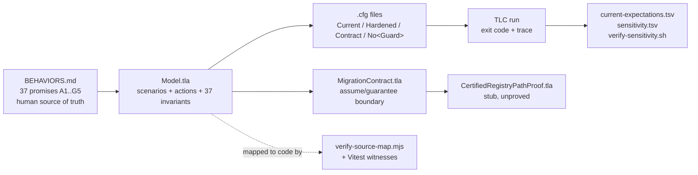

# Reading the ENS manager migration TLA+ model: a beginner walkthrough

For: an ENS Labs TypeScript/React engineer who is new to TLA+.
Source: [`apps/manager/verification/migration`](https://github.com/ensdomains/apps-monorepo/tree/formal/migration-model/apps/manager/verification/migration) on the `formal/migration-model` branch of `ensdomains/apps-monorepo` (head `7a6b91c`). Line anchors below point at that branch.
TLC runs: done on 2026-11-15 (UTC+8). Trimmed logs are in [`tlc-runs/`](./tlc-runs/).

There are no Lean files in this folder yet, so this tutorial is TLA+ only.

---

## 1. The 5-minute mental model

**TLA+ describes a system as a state machine, then checks claims about every possible run.**

| TLA+ word | Plain meaning | TypeScript analogy |
|---|---|---|
| state | one assignment of values to all variables | one snapshot of your XState context / Redux store |
| action | a rule for one step: "if these conditions hold, the next state looks like this" | a reducer case whose guard must be true for it to fire |
| behavior | a sequence of states, start to finish | one recorded session of state transitions |
| `Init` | which states a run can start in | `initialState` (but can be a *set* of starting states) |
| `Next` | "any one of these actions happens next" | the union of all reducer cases |
| invariant | something true in **every** reachable state | an `assert()` you run after every dispatch |
| temporal property | something about the **shape of runs over time** ("eventually", "always leads to") | "this promise always settles" — can't be checked from one snapshot |

**TLC** is the model checker. It starts from every `Init` state, applies every enabled action, de-duplicates states it has seen, and keeps going breadth-first until nothing new appears. At each new state it evaluates the invariants. If one is false, it prints the shortest path (the *error trace*) from an initial state to the bad state. It is exhaustive over the finite model, not a proof about the real TypeScript.

How this folder fits together:



The key design choice in this model: each promise (A1, A2, …) gets its **own tiny scenario**. `Init` picks one scenario, and only that scenario's actions can fire. A separate `CORE` scenario runs the integrated happy-ish lifecycle (start → persist intent → prompt → record hash → block on missing receipt → resolve → verify → checkpoint → repeat for the child name → complete).

Every behavior is modelled with a **guard** (e.g. `CopyRouteGuard`). The model has two modes:
- `"current"`: guards the implementation was observed to be missing (`CurrentMissingGuards`) are off.
- `"hardened"`: every guard is on.

---

## 2. Cheat sheet: only the operators these files use

| TLA+ | Meaning | TypeScript-ish |
|---|---|---|
| `X == e` | define X (a macro/function, not assignment) | `const X = () => e` |
| `/\ a` `/\ b` (bulleted) | AND; indentation groups bullets | `a && b` |
| `\/ a` `\/ b` | OR | `a \|\| b` |
| `~a` | NOT | `!a` |
| `a => b` | implies ("if a then b"; true when a is false) | `!a \|\| b` |
| `=` / `#` | equals / not equals | `===` / `!==` |
| `x \in S` | membership | `S.has(x)` |
| `A \subseteq B` | every element of A is in B | `[...A].every(x => B.has(x))` |
| `A \cup B`, `A \cap B`, `A \ B` | union, intersection, difference | `new Set([...A, ...B])` etc. |
| `{}` / `{"a","b"}` | sets | `new Set()` |
| `SUBSET S` | all subsets of S | power set |
| `Cardinality(S)` | size (from `FiniteSets`) | `S.size` |
| `0..2` | integer range | `[0,1,2]` |
| `BOOLEAN` | `{TRUE, FALSE}` | `boolean` |
| `<<a, b>>` | tuple / sequence | `[a, b] as const` |
| `Seq(S)` | all finite sequences over S | `S[]` |
| `[f \|-> 1, g \|-> 2]` | record literal | `{ f: 1, g: 2 }` |
| `r.f` | field access | `r.f` |
| `[r EXCEPT !.f = 3, !.g = 4]` | copy of r with fields replaced | `{ ...r, f: 3, g: 4 }` |
| `@` inside EXCEPT | the old value of that field | `r.f` in `{...r, f: r.f + 1}` |
| `x'` | value of x in the **next** state | the new store after the reducer |
| `UNCHANGED x` | `x' = x` | field not touched |
| `IF c THEN a ELSE b` | conditional expression | `c ? a : b` |
| `CASE p -> a [] q -> b [] OTHER -> c` | multi-way conditional | `switch(true)` |
| `\E x \in S : P(x)` | there exists | `[...S].some(P)` |
| `\A x \in S : P(x)` | for all | `[...S].every(P)` |
| `[][Next]_vars` | "every step is a Next step or leaves vars unchanged" | the store only ever changes through the reducer |
| `WF_vars(A)` | weak fairness: if A stays enabled, it eventually happens | "the RPC eventually answers" |
| `CONSTANTS`, `VARIABLES` | inputs set by the .cfg; mutable state | config / store fields |
| `ASSUME P` | sanity check on constants | runtime config validation |
| `EXTENDS M` | import a standard module | `import` |
| `INSTANCE M WITH a <- b` | import M with its constants/vars substituted | dependency injection |
| `M!X` | X from an instance | `M.X` |
| `THEOREM` | claim for the TLAPS prover (not TLC) | — |
| `\*` / `(* *)` | comments | `//` / `/* */` |

---

## 3. Line-by-line walkthrough of Model.tla

Excerpt chosen: module header → constants/guard switch → `Init` → two `CORE` lifecycle actions (persist intent, then prompt) → `Next` → `Spec` → the `A3` invariant, which is the promise those two CORE steps exist to keep.

### 3.1 Header and constants ([L1-L4](https://github.com/ensdomains/apps-monorepo/blob/formal/migration-model/apps/manager/verification/migration/Model.tla#L1-L4))

```tla
------------------------------ MODULE Model ------------------------------
EXTENDS FiniteSets, Naturals, Sequences

CONSTANTS ModelMode, DisabledGuard, EnabledScenarios
```
- Line 1: a module named `Model`; the name must match the file name. The dashes are decoration.
- Line 2: import standard modules: `FiniteSets` (gives `Cardinality`), `Naturals` (numbers, `..`), `Sequences` (`Seq`).
- Line 4: three knobs the `.cfg` file fills in: which mode, which single guard to switch off, which scenarios may run.

Small world ([L6-L7](https://github.com/ensdomains/apps-monorepo/blob/formal/migration-model/apps/manager/verification/migration/Model.tla#L6-L7)):
```tla
Tabs == {"tab-1", "tab-2"}
Names == {"root.eth", "child.root.eth"}
```
Two browser tabs and two names (a parent and its subname) are enough to show cross-tab races and parent/child ordering. TLC needs finite sets.

### 3.2 The guard switch ([L102-L104](https://github.com/ensdomains/apps-monorepo/blob/formal/migration-model/apps/manager/verification/migration/Model.tla#L102-L104))

```tla
GuardEnabled(guard) ==
  /\ guard # DisabledGuard
  /\ (ModelMode = "hardened" \/ ~(guard \in CurrentMissingGuards))
```
A guard is on when (a) it isn't the one a mutation config disabled, and (b) we're in hardened mode, or the current code is believed to have it. TS: `guard !== disabled && (mode === "hardened" || !currentMissing.has(guard))`.

### 3.3 Variables and Init ([L195-L201](https://github.com/ensdomains/apps-monorepo/blob/formal/migration-model/apps/manager/verification/migration/Model.tla#L195-L201))

```tla
VARIABLES scenario, state

vars == <<scenario, state>>

Init ==
  /\ scenario \in EnabledScenarios
  /\ state = DefaultState
```
- Only two variables. `state` is one big record (~85 fields: `intents`, `submissions`, `recoveryNames`, `promptCount`, …) defined as `DefaultState` at L106-L193.
- `vars` bundles them for `[][Next]_vars` and fairness.
- `Init`: `scenario \in EnabledScenarios` is non-deterministic: TLC makes one initial state **per** enabled scenario. With all 37 enabled, TLC reported "37 distinct states generated" for the initial states.

Helper ([L203-L205](https://github.com/ensdomains/apps-monorepo/blob/formal/migration-model/apps/manager/verification/migration/Model.tla#L203-L205)):
```tla
SetState(next) ==
  /\ state' = next
  /\ UNCHANGED scenario
```
"The next `state` is `next`, and the scenario doesn't change."

### 3.4 Two CORE lifecycle actions ([L937-L951](https://github.com/ensdomains/apps-monorepo/blob/formal/migration-model/apps/manager/verification/migration/Model.tla#L937-L951))

```tla
CorePersistRoot ==
  /\ scenario = "CORE"
  /\ state.phase = 1
  /\ SetState([state EXCEPT
       !.phase = 2,
       !.intents = {Root},
       !.recoveryNames = Names])
```
- An action is just a boolean formula over current (`state`) and next (`state'`) values.
- `scenario = "CORE"` and `state.phase = 1` are **enabling conditions**: if either is false the action can't fire. `phase` is a hand-rolled program counter.
- The update: move to phase 2, write a durable intent for `root.eth` into the journal, and record a recovery route covering both names. TS: `{ ...state, phase: 2, intents: new Set([Root]), recoveryNames: Names }`.

```tla
CorePromptRoot ==
  /\ scenario = "CORE"
  /\ state.phase = 2
  /\ SetState([state EXCEPT
       !.phase = 3,
       !.promptingTabs = {"tab-1"},
       !.promptCount = 1])
```
- Only reachable after persisting (phase 2). Opens one wallet prompt in tab 1.
- Ordering by phase is what encodes "write the journal entry before opening the wallet."

### 3.5 Next ([L1066-L1088](https://github.com/ensdomains/apps-monorepo/blob/formal/migration-model/apps/manager/verification/migration/Model.tla#L1066-L1088), abridged)

```tla
Next ==
  \/ A1FirstPrompt \/ A1SecondPrompt
  ...
  \/ CoreStart \/ CorePersistRoot \/ CorePromptRoot \/ CoreRecordRoot
  ...
  \/ CoreComplete \/ Done
```
"One step = any one action that is enabled." Because each action checks `scenario = "..."`, only the chosen scenario's actions are ever enabled. `Done` ([L1062-L1064](https://github.com/ensdomains/apps-monorepo/blob/formal/migration-model/apps/manager/verification/migration/Model.tla#L1062-L1064)) is `state.phase = 99 /\ UNCHANGED vars`: a terminal "stutter" step so finished runs are not reported as deadlocks.

### 3.6 Spec ([L1090-L1093](https://github.com/ensdomains/apps-monorepo/blob/formal/migration-model/apps/manager/verification/migration/Model.tla#L1090-L1093))

```tla
Spec ==
  /\ Init
  /\ [][Next]_vars
  /\ (scenario = "CORE" => WF_vars(CoreResolveRoot))
```
- Start in `Init`; every step is a `Next` step (or a stutter).
- Fairness: in CORE, if resolving the pending receipt stays possible, it eventually happens ("the chain eventually answers"). Fairness only matters for temporal properties, so it only affects `Contract.cfg`'s `PROPERTY`.

### 3.7 An invariant tied to a promise ([L1191-L1194](https://github.com/ensdomains/apps-monorepo/blob/formal/migration-model/apps/manager/verification/migration/Model.tla#L1191-L1194))

[BEHAVIORS.md A3](https://github.com/ensdomains/apps-monorepo/blob/formal/migration-model/apps/manager/verification/migration/BEHAVIORS.md#L49-L59) says: *"Every atomic-batch wallet prompt must have a durable intent and recovery route before the prompt opens."*

```tla
A3_IntentBeforePrompt ==
  scenario = "A3" /\ state.promptCount > 0 =>
    /\ state.intents # {}
    /\ state.intents \subseteq state.recoveryNames
```
- Read it as: "In scenario A3, once any prompt has opened, the journal holds an intent and every intent has a recovery route."
- `=>` makes it vacuously true before any prompt, and in every other scenario.
- Important detail: the invariant is **scoped to scenario A3**. The CORE actions above follow the same rule, but CORE is checked against the contract's `EveryPromptHasDurableIntent` guarantee via `Contract.cfg`, not against `A3_IntentBeforePrompt`.

The A3 scenario's own action ([L254-L270](https://github.com/ensdomains/apps-monorepo/blob/formal/migration-model/apps/manager/verification/migration/Model.tla#L254-L270)) has the `IF GuardEnabled("IntentRecoveryBeforePrompt") THEN … ELSE …` shape every scenario uses: the THEN branch writes `intents` and `recoveryNames` before the prompt; the ELSE branch opens the prompt without them.

---

## 4. Reading the .cfg files

A `.cfg` tells TLC which spec to run, what values to give constants, and what to check.

[Current.cfg L1-L8](https://github.com/ensdomains/apps-monorepo/blob/formal/migration-model/apps/manager/verification/migration/Current.cfg#L1-L8) (scenario list shortened here):
```
SPECIFICATION Spec

CONSTANTS
  ModelMode = "current"
  DisabledGuard = "None"
  EnabledScenarios = {"A1", "A2", ..., "G5"}

INVARIANT TypeOK
```
- `SPECIFICATION Spec`: use the `Spec` formula (Init + Next + fairness).
- `CONSTANTS`: fill in the three knobs. All 37 promise scenarios, but **not** `"CORE"`.
- Then 38 `INVARIANT` lines: `TypeOK` plus one per promise.
- Last line `CHECK_DEADLOCK FALSE`: don't treat "no next step" as an error.

**Hardened.cfg** is identical except line 4: `ModelMode = "hardened"`. That's the whole difference: every guard is switched on, and all invariants must pass.

**[NoCopyRouteGuard.cfg](https://github.com/ensdomains/apps-monorepo/blob/formal/migration-model/apps/manager/verification/migration/NoCopyRouteGuard.cfg)** (complete, 11 lines):
```
SPECIFICATION Spec

CONSTANTS
  ModelMode = "hardened"
  DisabledGuard = "CopyRouteGuard"
  EnabledScenarios = {"E4"}

INVARIANT TypeOK
INVARIANT E4_CopyRequiresRoute

CHECK_DEADLOCK FALSE
```
Hardened mode, minus exactly one guard, running only the E4 scenario, checking only E4's invariant.

**What the 37 `No<Guard>.cfg` files are for: mutation / sensitivity testing.** A passing check is only meaningful if it *could* fail. Each No* file switches off one guard and expects the matching invariant to break. [`sensitivity.tsv`](https://github.com/ensdomains/apps-monorepo/blob/formal/migration-model/apps/manager/verification/migration/sensitivity.tsv) lists `config, behaviour, guard, invariant` per row. [`verify-sensitivity.sh`](https://github.com/ensdomains/apps-monorepo/blob/formal/migration-model/apps/manager/verification/migration/verify-sensitivity.sh#L51-L67) runs each one and requires TLC exit code `12` **and** the line `Error: Invariant <that invariant> is violated` — so a mutant that fails for the wrong reason (another invariant, a parse error) is caught. The same script requires `Current.cfg` to fail with exit 12, and `Hardened.cfg` and `Contract.cfg` to pass.

---

## 5. Reading TLC output (real runs)

Setup used: `tla2tools.jar` v1.7.4 from the [official release](https://github.com/tlaplus/tlaplus/releases/tag/v1.7.4) (checksum matched the one pinned in `verify-sensitivity.sh`), Temurin Java 21, same flags as the script:

```sh
java -XX:+UseParallelGC -cp tla2tools.jar tlc2.TLC -workers 1 -fp 0 -config Hardened.cfg Model
```

Every run finished in under a second, so no reduced runs were needed.

### 5.1 Success: Hardened.cfg

```
Finished computing initial states: 37 distinct states generated ...
Model checking completed. No error has been found.
124 states generated, 81 distinct states found, 0 states left on queue.
The depth of the complete state graph search is 3.
```
- 37 initial states = one per scenario.
- "generated" counts every successor computed (including repeats); "distinct" counts unique states. 81 distinct states total.
- "0 states left on queue" = the search finished. Anything else means it was cut off.
- Depth 3 = the longest shortest-path from an initial state is 3 states. Most scenarios are a single step, so the state space is tiny.
- Exit code 0.

### 5.2 Invariant violation with an error trace: NoCopyRouteGuard.cfg

```
Error: Invariant E4_CopyRequiresRoute is violated.
Error: The behavior up to this point is:
State 1: <Initial predicate>
State 2: <E4CopyRoute line 754, col 3 to line 766, col 28 of module Model>
```
Fields that changed between State 1 and State 2 (TLC prints the full record; trimmed here):
```
copied:          FALSE -> TRUE
copyRouteExists: TRUE  -> FALSE
phase:           0     -> 99
```
How to read it: State 1 is the initial state; each next state is labelled with the action that produced it and its source location. Here `E4CopyRoute` with the guard off copied a name although no copy route existed, which breaks `E4_CopyRequiresRoute == scenario = "E4" /\ state.copied => state.copyRouteExists`. Exit code 12 (safety violation), which is exactly what the mutation test wants.

### 5.3 Current.cfg: real counterexample

```
Error: Invariant A5_PendingAttemptNeverReprompts is violated.
State 2: <A5MissingReceipt line 290, col 3 to line 309, col 30 of module Model>
42 states generated, 42 distinct states found, 36 states left on queue.
```
Changed fields: `promptCount 0 -> 2`, `receiptOutcome "none" -> "unavailable"`, `submissions` stays `{}`. In product words: when a receipt read is unavailable, the current code drops the pending submission and can prompt the wallet again.
Note "36 states left on queue": TLC **stops at the first violation**. To see every current result you must check each property separately. I did that (one generated config per property): all 37 matched `current-expectations.tsv` (11 violate, 26 hold). See `tlc-runs/current-per-property-summary.tsv`.

### 5.4 Deadlock

The real model never deadlocks (the `Done` stutter step keeps finished runs enabled, and the configs set `CHECK_DEADLOCK FALSE`; turning it on for Hardened still passes). To show what a deadlock report looks like, I ran a **scratch copy** with `Done` removed from `Next` and `CHECK_DEADLOCK TRUE`:
```
Error: Deadlock reached.
State 1: <Initial predicate>
State 2: <E4CopyRoute line 754, col 3 to line 766, col 28 of module Model>
```
Exit code 11. Deadlock = a reachable state where no action is enabled. Sometimes that's a bug (a stuck run), sometimes it's just "finished"; that's why models add a `Done` step.

### 5.5 Temporal property: Contract.cfg

```
Implied-temporal checking--satisfiability problem has 2 branches.
16 states generated, 15 distinct states found, 0 states left on queue.
Checking 2 branches of temporal properties for the complete state space with 30 total distinct states
Model checking completed. No error has been found.
The depth of the complete state graph search is 15.
```
Only CORE runs here: one straight line of 15 states. The `PROPERTY ContractRefinement` line makes TLC check that every behavior of `Model` is also a behavior of `MigrationContract`'s spec (refinement), which is a temporal check over the whole graph.

### 5.6 Coverage

`-coverage 1` prints, per action, `distinct:generated`. On Hardened every scenario action fired; `C5ReportPartialThroughFailure` showed `0:1` (fired once but only produced an already-seen state), and every `Core*` action showed `0:0` because CORE isn't enabled in Hardened.cfg. A `0:0` action in a config that is supposed to exercise it is a red flag: that code path was never checked.

### 5.7 TLC exit codes

From [`EC.java`](https://github.com/tlaplus/tlaplus/blob/master/tlatools/org.lamport.tlatools/src/tlc2/output/EC.java) (`ExitStatus`): 0 success, 10 assumption violated, 11 deadlock, 12 safety/invariant violation, 13 liveness violation, 150+ parse/config errors.

### 5.8 Full sensitivity sweep

All 37 `No*.cfg` runs exited 12 with the expected invariant (37/37). Together with Hardened and Contract passing and Current failing, this reproduces what `verify-sensitivity.sh` checks (I did not run its `verify-source-map.mjs` step, which needs the git checkout).

---

## 6. The other files

- **MigrationContract.tla** ([file](https://github.com/ensdomains/apps-monorepo/blob/formal/migration-model/apps/manager/verification/migration/MigrationContract.tla)): an abstract, generic version of the migration with one record variable `contractState`, parameterized actions like `Prompt(tab, names)` chosen with `\E names \in SUBSET Names`, `EnvironmentAssumptions` (honest journal/chain/wallet, fair responses, exact fuse-derived roles, certified registry path) and seven `Guarantees` (one prompt per scope, no prompt after cancel, durable intent before every prompt, …). `Model.tla` maps its big state onto this record (`ContractState`, L1376) and instantiates it ([L1396-L1403](https://github.com/ensdomains/apps-monorepo/blob/formal/migration-model/apps/manager/verification/migration/Model.tla#L1396-L1403)). Think of it as the public interface type the integrated model must satisfy.
- **CertifiedRegistryPathProof.tla** ([file](https://github.com/ensdomains/apps-monorepo/blob/formal/migration-model/apps/manager/verification/migration/CertifiedRegistryPathProof.tla)): a **stub**. It states a `THEOREM` that every subregistry reachable from root is certified, with the proof omitted. Until the contracts team supplies a real proof, `CertifiedRegistryPathAssumption` is assumed, not proved.
- **Model.view.mjs**: labels for a statechart/counterexample report tool, translating scenario/action names into product language. Not used by TLC.
- **verify-source-map.mjs**: fails if any of the covered TypeScript files differ from the recorded sync commit. It checks provenance ("is this still the code we modelled?"), not behavior.
- **real-code-matrix.test.ts** (Vitest): table-driven tests against the real `classifyNames` and journal reconciliation code, backing E3 and routing assumptions.
- **partial-success-refresh.test.tsx** (Vitest + Testing Library): renders `MigrationPage` after a partial failure and expects all refresh side effects; per the README it is a regression witness expected to stay red until C5 is fixed.

---

## 7. Checklist when an agent hands you a new model

1. **Promise → invariant mapping.** For each promise in BEHAVIORS.md, find its invariant and read it in plain English. Does it say what the promise says, or something weaker?
2. **Vacuity.** Every invariant here is `scenario = "X" /\ condition => …`. Make sure the condition is actually reached (coverage, or a mutant that fails). An implication whose left side is never true checks nothing.
3. **Liveness written as an invariant.** "Eventually" promises (G1, G2) are written here as invariants that only check states with `phase = 99`. They don't prove a run reaches phase 99; only `Contract.cfg`'s `PROPERTY` is a real temporal check. Ask whether that's intended.
4. **Does the guard's ELSE branch model the real bug, or was it written to fail?** In these one-step scenarios the bad branch is hand-written, so a mutant failing mostly proves the invariant can see that field. The real evidence is the mapping to code (source map + Vitest).
5. **What's enabled in each config?** Hardened.cfg doesn't include CORE; CORE is only checked by Contract.cfg.
6. **State space size and queue.** "0 states left on queue" and a plausible distinct-state count. Tiny depth means tiny scenarios.
7. **Exit codes and expected-failure files.** Exit 12 must name the intended invariant.
8. **Assumptions.** Read every `ASSUME`, `EnvironmentAssumptions`, and stub `THEOREM`; those are things nobody has checked.
9. **Provenance.** Is the sync commit current with the code you're shipping?

---

## References

- Leslie Lamport, The TLA+ Home Page: https://lamport.azurewebsites.net/tla/tla.html
- Lamport, The TLA+ Video Course: https://lamport.azurewebsites.net/video/videos.html
- Lamport, Specifying Systems (book, free PDF): https://lamport.azurewebsites.net/tla/book.html
- Lamport, A Summary of TLA+ (operator reference): https://lamport.azurewebsites.net/tla/summary-standalone.pdf
- Lamport, Current Versions of the TLA+ Tools (TLC options): https://lamport.azurewebsites.net/tla/current-tools.pdf
- Hillel Wayne, Learn TLA+: https://learntla.com/ (invariants: https://learntla.com/core/invariants.html, temporal logic: https://learntla.com/core/temporal-logic.html, CLI: https://learntla.com/topics/cli.html)
- TLA+ docs: https://docs.tlapl.us/
- tlaplus/tlaplus releases (tla2tools.jar): https://github.com/tlaplus/tlaplus/releases/tag/v1.7.4
- TLA+ examples: https://github.com/tlaplus/Examples
